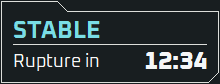

# StarRupture Overlay

Keep rupture timing and recipe research progress visible while you play StarRupture.

This unofficial Windows companion adds a rupture countdown and an optional recipe tracker over the game. It reads the running game without changing game files, memory or saves.

*Example display; the time shown is illustrative.*

## What it does

- Shows the current rupture stage and time remaining, with a countdown that follows the game's simulation and pauses with it.
- Pins up to three recipes in compact panels, showing submitted materials, required amounts and completion.
- Shows which recipe materials you have in your bag and how many you carry.
- Offers controls for positioning, recipe scale, keyboard shortcut, starting with Windows and launching the game.

## Download and start

The first packaged release is being prepared. No public app download is available yet. When a build is published, it will appear on the [Releases page](https://github.com/ahjephson/star-rupture-overlay/releases).

1. Download the **Windows x64 ZIP** from Releases. The GitHub **Source code** downloads are not the app.
2. Extract the complete ZIP to a folder you want to keep. Keep the included files together.
3. Open `starrupture-overlay.exe`, then start StarRupture and load your world. You can also choose **Start StarRupture** from the overlay's tray menu.
4. Right-click the overlay icon in the Windows notification area for **Settings**, positioning controls and **Exit**. The icon may be under the notification area's hidden icons arrow.

The app finds the running game automatically. Run it normally, without administrator rights. There is no installer or separate developer tool to install.

### Requirements

- Windows 10 or 11, 64-bit.
- The supported Steam version of StarRupture in borderless, windowed or fullscreen mode. See [supported environment](docs/COMPATIBILITY.md) for the fullscreen compatibility scope.
- A supported installed game for recipe setup. The app prepares icons, names and the font locally using its built-in Rust reader. Setup works offline and later launches reuse the local cache.

Game updates can temporarily break compatibility. Check [supported environment](docs/COMPATIBILITY.md) if the overlay cannot connect.

### Windows SmartScreen

The app is unsigned, so Windows may show **Windows protected your PC** when you first open a downloaded build. If you have checked the download source and trust the app, choose **More info**, then **Run anyway**. A new download or update may prompt again. Release ZIPs include a matching SHA256 checksum so you can check the download; see [download verification](docs/SUPPORT.md#checking-a-download).

## Using the overlay

Right-click the notification-area icon for controls, or double-click it to open Settings. To pin research progress, hover over an unfinished recipe in the station and press **Alt+X**, or double-click its icon or name. Pin up to three recipes; each panel closes when its recipe is completed.

The [features guide](docs/FEATURES.md) covers the rupture countdown, recipe counters and shortcuts, positioning, automatic setup and app controls.

## Updating or removing the app

For an update, exit the overlay from its tray menu and extract the new ZIP to a new folder. Keep the old folder until you have checked the new version. Open the new copy's Settings and choose **Update shortcut** if the desktop shortcut points to another copy, or **Create shortcut** if it is missing. If you use Start with Windows, disable it in the old copy's Settings and enable it in the new copy.

To remove the app, disable Start with Windows and remove its desktop shortcut in Settings, exit it, then delete its extracted folder. Preferences and caches are stored separately under `%LOCALAPPDATA%/StarRuptureWaveOverlay`; you can delete that folder too if you want to remove its local data.

## Help and feedback

See [troubleshooting](docs/SUPPORT.md) if the overlay is missing, the countdown shows `--:--`, or recipe setup cannot finish. **About > Copy support details** provides version and connection information for a bug report.

[Bug reports and feature requests](https://github.com/ahjephson/star-rupture-overlay/issues) are welcome. This project is maintained by its owner; **pull requests and code contributions are not accepted**. See the [feedback policy](CONTRIBUTING.md) and [security reporting guidance](SECURITY.md).

## Licence

First-party code and app/tray icon artwork are licensed under [PolyForm Strict 1.0.0](LICENSE), copyright (c) 2026 Alex Jephson. Source availability does not grant permission to modify or redistribute the app; consult the licence for its terms. Dependencies and fonts retain their own licences; see [third-party notices](THIRD-PARTY-NOTICES.md).

An unofficial community utility, unaffiliated with the developers or publisher of StarRupture.
